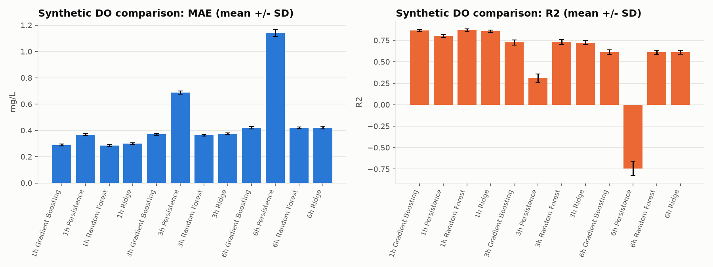
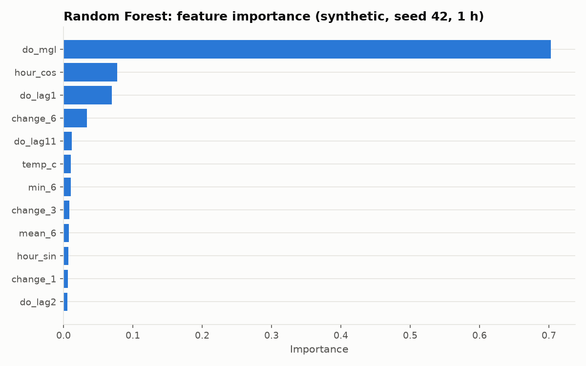

# BangusSmart – Machine Learning Prototype

## Calibrated media analysis module

Run from this folder using the existing virtual environment:

```powershell
.\.venv\Scripts\python.exe -m pip install -r requirements.txt
.\.venv\Scripts\python.exe -m uvicorn api:app --host 127.0.0.1 --port 8000
```

Open **http://127.0.0.1:8000/media** for the new measurement page. The main dashboard remains at `/`. Alternatively, the requested standalone app is available with `python -m uvicorn api_media:app --host 127.0.0.1 --port 8001` (open http://127.0.0.1:8001/). API schemas are at `/docs` on either app.

This module measures geometry, not exact age. A photo **cannot reveal exact age**. The default method segments dark, elongated silhouettes on a plain light background, detects a fork landmark heuristically and measures a **snout-to-fork length proxy**. It does not verify that a contour is a bangus. All media results have low, uncalibrated confidence and require review of the annotated endpoints. Overlapping, curved, partly hidden or low-contrast fish may be rejected or measured incorrectly.

### Required capture protocol

- Use a straight side view in a shallow white/light tray or clear tank, plain background and even lighting. Show the whole snout and forked tail; separate individual fish.
- Include an **8 × 6 square checkerboard** (7 × 5 inner corners), flat and in the **same plane** as the fish. Download `/media/reference.svg`, print at 100% and **measure a physical square in cm**. Enter its real size. This implementation detects this checkerboard; it does not automatically detect an arbitrary ruler.
- Keep the camera perpendicular to the board/fish plane. Strongly distorted boards and blurry fish are rejected. A flat board cannot prove that a fish is coplanar: the operator must ensure that.
- No detectable board returns `cannot_measure_scale` / “Cannot measure scale”; the program never guesses pixels-per-cm.
- For video, keep camera and board stationary, and the checkerboard visible in every frame. Use <=180-second clips, <=50 MB, <=8.5 million pixels/frame. Photos: JPEG/PNG/WebP, <=8 MB, <=25 million pixels.

The UI shows this protocol and the printable board. [DATA_COLLECTION_MEDIA.md](DATA_COLLECTION_MEDIA.md) gives the cooperative's capture, weighing, labelling and split procedure.

### Weight, culture age and feeding

The module converts fork-length proxies to weight using `W_g = a * L_cm**b`. All parameters and quality/tracking thresholds live in [media_config.json](media_config.json). Defaults use the published juvenile fork-length relation from [Bagarinao & Thayaparan (1986)](https://repository.seafdec.org.ph/handle/10862/1059): `log10(W_g) = -5.6083 + 3.2598*log10(L_mm)`. Converting mm to cm gives `a = 0.004482290499966204`, `b = 3.2598`. The source covers 31 wild juveniles with fork lengths 9.2–18.6 cm in Sri Lanka. The parameters remain **PLACEHOLDER_FOR_LOCAL_USE**, not a validated Hayuma relationship. Outside that length range, weight and derived feed/age are unavailable; the system does not silently extrapolate. If any detected fish is outside calibration, batch average weight is withheld rather than excluding that fish from biomass.

The existing synthetic growth model is inverted by enumerating days 0–147 at the supplied mean water temperature (supported 26.5–31.5 °C). Age point is the median nearest-match day. The range includes days matching a configurable ±25% weight envelope and at least ±14 days around the point, clipped to the model domain. **Both widths are ASSUMPTION/PLACEHOLDER and the range is not a calibrated confidence interval.** Unmatched weights or unsupported temperatures return null point/range with confidence `unavailable`, never a clamped boundary estimate.

If stocking date or known batch age is supplied, recorded **days since stocking** become primary with range `[day, day]` and confidence `recorded_unverified`. The visual/weight-derived estimate is retained as a separate cross-check. An absolute point difference divided by recorded days above 20% is flagged. At recorded day zero, any nonzero estimate is flagged. Recorded days are not proof of birth age; age at stocking is unknown. Source dates and known batch age must agree.

Feed uses the shared `calculate_feed()` function extracted from `advise()`: weight × count / 1,000 → biomass kg; multiply by daily rate/100 and `FEED_FACTOR`. Rates, including user overrides, are capped at **4% biomass/day**. Existing `FEED_TABLE` remains PLACEHOLDER and `FEED_FACTOR` remains ASSUMPTION. With an hourly DO history supplied through the API, the original `advise()` forecast policy can reduce Good to Warning. Missing water readings never default to Good. User stock count takes priority; video track count can supply a clearly labelled estimate when no user count exists. Still-image candidate count is not assumed to be batch stock. Reported per-meal quantities are equal mathematical portions, not an independently validated feeding schedule. Feed product/pellet size is not identified from images.

### Video tracking and CSV data

Video frames are sampled at a user-configurable rate (default 1/s, up to 180 sampled frames). Frames with no reference, blurry fish or no measurable candidates are skipped with per-frame reasons. Association uses checkerboard-relative position and length with global assignment; each track reports median length and median per-frame estimated weight. The estimated distinct count is the number of tracks. It is not a verified stock count: crossing, occlusion, re-entry, rapid movement or long rejected-frame gaps can split/merge identities. Up to six accepted annotated frames are returned; no trained identity model or ByteTrack accuracy is claimed.

CSV accepts the existing complete schemas: `day,hour,temp_c,ph,do_mgl` and `batch,day,mean_temp_c,avg_weight_g`, including combined rows. It validates numeric/integer ranges and all rows before analysis. Errors include CSV row and column; invalid files are not silently partially analyzed. Latest day/hour is used per batch, and sensor mean temperature is the arithmetic mean of supplied readings. Sampling regularity is not inferred. Multiple batches are reported separately. The UI can copy one selected batch's validated settings into the media form; it does not automatically combine unrelated sensor and growth batches. A sensor-only CSV has no fish weight, so feed remains unavailable until media or growth measurements provide it.

### API upload contract

`POST /analyze/image`, `/analyze/video` and `/analyze/csv` take **raw file bytes**, with an `options` query parameter containing a JSON `AnalysisOptions` object. Image/video options require `square_size_cm` from a physical measurement; CSV does not need geometric scale and defaults it to an unused 1. Video also accepts a `filename` query parameter for its container extension. No multipart form dependency is needed. JSON returns size, weight, primary age point/range, cross-check, confidence, warnings, feeding kg, annotated paths and the exact configuration used. Rejections return HTTP 422 with a code/reason and quality details; oversized uploads return 413.

```powershell
$options = @{ square_size_cm=1.0; mean_temp_c=29; fish_count=5000; temp_c=29; ph=8; do_mgl=6 } | ConvertTo-Json -Compress
$query = [uri]::EscapeDataString($options)
Invoke-RestMethod -Uri "http://127.0.0.1:8000/analyze/image?options=$query" -Method Post -ContentType 'application/octet-stream' -InFile '.\my_photo.png'
```

Saved analysis JSON/annotated media are in `data/media_results/<run_id>/`. Raw analysis-video uploads are temporary and removed after decoding. The earlier record-only photo/video storage remains separate. Restart the server after changing model/configuration files.

### Optional pretrained segmentation and local refitting

The classical pipeline needs no pretrained weights and no training images. An **optional, untested-on-real-fish** local Ultralytics segmentation adapter is included. To use your existing local fish segmentation weights, install `requirements-media-yolo.txt` separately, set `detector.backend` to `local_yolo` and `detector.local_yolo_weights` to that local file in configuration. Configure class names. If the package, weights or fish masks are absent, output explicitly reports the classical fallback. No pretrained weights, images or datasets are downloaded automatically. No claim is made that a generic pretrained COCO detector can identify bangus. Only the classical path and missing-local-model fallback have been exercised here.

Refit length-weight parameters on **training measurements only**, producing a separate configuration:

```powershell
python media_estimation.py training_lengths_weights.csv --output media_config_fitted.json
```

Required columns are `measured_length_cm,measured_weight_g` (fork length in cm, weight in g); at least three distinct positive lengths. An optional `split` column must contain only `train`. Log-space least squares fits `a,b` without a lognormal bias correction and restricts calibration to the observed length range. The routine never runs during evaluation; a refit is not proof of test accuracy.

### Tests and evaluation

```powershell
python synthetic_media.py
python -m pytest -q
python evaluate_media.py data/template_image_labels.csv data --output data/media_evaluation_no_labels.json
python evaluate_media.py heldout_labels.csv heldout_images --config media_config_fitted.json --output media_evaluation.json
```

The label template is header-only, with exactly `image_file,capture_date,batch,known_age_days,measured_length_cm,measured_weight_g,reference_object,notes`. Do not fill it with invented labels. Evaluation requires one fish/image and explicit `reference_object` such as `checkerboard:1.0cm`; it accepts an optional per-row `mean_temp_c` and optional `split=test`. It does **not** supply the known-age label to inference. It reports signed error mean/sample SD, MAE, RMSE, range coverage, quality rejection share, unscorable files and individual outcomes. An empty label file reports **no real labelled images and no scores**. Synthetic evaluation must be labelled `--synthetic`. Never tune on test images; use separate fish/batch/session splits.

Measured phase checks and their limitations are recorded in [MEDIA_IMPLEMENTATION_NOTES.md](MEDIA_IMPLEMENTATION_NOTES.md). No real-fish accuracy is claimed. Before any accuracy claim, collect known-batch-age photographs, manually measured fork lengths and weights, verified physical scales, water records and true fish identities/counts for video, and hold out complete sessions/batches. Also validate the feeding policy with cooperative personnel.

## Earlier record-only dashboard, uploads and age records

Run `.\.venv\Scripts\python.exe -m uvicorn api:app --host 127.0.0.1 --port 8000` from this directory and open http://127.0.0.1:8000/.

The dashboard follows the supplied mockup's navigation, teal theme and card layout. Devices & Data imports UTF-8 CSV files (5 MB / 10,000 rows); download a template there. Uploaded datasets persist in `data/dashboard.sqlite3`. Invalid rows are reported and excluded. Tables display up to the last 200 valid rows, in file order. Dates default to the date selected on import, not inferred from sensor readings.

Growth & Feeding accepts JPEG, PNG and WebP photos up to 8 MB / 25 million pixels. Photos and their supplied measurements persist in `data/photos/`. A photo is a visual record: this project has **no trained image-to-age model** and does not detect species, size or weight from a photo.

The combined analysis form also accepts MP4, MOV, WebM and AVI videos up to 50 MB, 3 minutes and 8.5 million pixels per frame. OpenCV decodes each upload, reads dimensions/duration/frame rate and extracts up to five representative frames. Photos are decoded to inspect dimensions, format and brightness. These inspections do not recognize fish or measure their ages or weights. Uploaded videos, extracted frames and analysis metadata persist in `data/videos/`. Codec support depends on OpenCV; an undecodable file returns an error. Browser playback depends on the browser's codec support; extracted JPEG frames remain viewable.

To analyze a sample:

1. Upload the farm CSV in Devices & Data, if available.
2. Open Growth & Feeding and choose a photo or video.
3. Select the matching CSV row to copy its measurements, or enter dates, measured average weight and the actual fish count manually. Review copied values for freshness and batch identity.
4. Add current water temperature, pH and dissolved oxygen for a feeding calculation. Set meals per day; optionally enter a farm-confirmed daily rate (% biomass).
5. Click Analyze record & save media. The result separates age calculation, feeding calculation and media inspection. Missing inputs stay unavailable, rather than being inferred from appearance.

The ration formula is measured average weight (g) × fish count ÷ 1,000 × daily rate (%) ÷ 100 × existing water-status multiplier. Daily feed is divided into equal portions by the chosen meal count. Default rates and water multipliers remain prototype assumptions, not a validated prescription. Feed brand, pellet size and a suitable feeding schedule cannot be identified from a sample image/video. Confirm these with the farm adviser or feed supplier. The existing dataset has no labels for training or evaluating image/video age recognition.

Age methods:

- Hatch date and observation date: biological age from your records.
- Stocking date or `day`: days of culture, not biological age.
- Measured `avg_weight_g` without dates: a rough match against the existing synthetic growth model over days 0–147 at mean temperatures 26.5–31.5 °C. Outside-range weights are rejected for estimation. Matching day ranges are model ties, not statistical confidence intervals. This inverse use of the model has no measured real-fish age accuracy.
- Photo only: age unavailable until a known date or measured weight is supplied.

The dashboard does not connect physical sensors. Water alerts summarize uploaded readings using existing rules. Feed calculations require measured weight and complete water readings in the same CSV row and retain the prototype's placeholder feeding assumptions. The existing `/advise` API still provides its one-hour oxygen forecast. Open `/docs` for the full API.

Run `.\.venv\Scripts\python.exe -m pytest -q` to check the original pipeline and new date, upload, persistence, photo-validation and age-boundary behavior.

Prototype of the machine-learning component described in the BangusSmart topic proposal
(IoT + ML smart aquaculture management for bangus farming, Hayuma Cooperative).

> **Read this first:** there is no real farm data yet, so the prototype trains on **synthetic data**
> that imitates a bangus farm. The scores below test that the *pipeline works*. They are **not**
> evidence of real-world accuracy. Real accuracy can only be reported after the models are trained
> and tested on data collected at the cooperative.

## 1. What is inside

| File / folder | Purpose |
|---|---|
| `bangussmart_ml.py` | The whole prototype (data generator, training, evaluation, advice function, demo) |
| `requirements.txt` | Python packages |
| `data/synthetic_*.csv` | Generated practice data (hourly sensor data, weekly fish weights) |
| `data/template_*.csv` | Column layout your **real** data must follow |
| `models/` | Saved trained models + `metrics.json` |
| `plots/` | Status, growth, DO forecast, feature importance and model comparison charts |

### The three modules

| # | Module | Input → output | Algorithm |
|---|---|---|---|
| 1 | Water-quality status | temperature, pH, DO, hour → Good / Warning / Critical | Gradient Boosting classifier |
| 2 | Dissolved-oxygen forecast | current DO, previous 3 or 12 hours, temp, pH, hour → DO one hour ahead | Original Gradient Boosting / enhanced Random Forest |
| 3 | Growth + feeding advice | day of culture, mean water temp → average fish weight → daily feed (kg) | Gradient Boosting regressor + feeding table |

Water-quality ranges come from SEAFDEC/AQD milkfish cage-culture guidance: pH 7.5–8.3, DO 4–8 mg/L,
temperature 26–32 °C. SEAFDEC also reports that supplemental pond feeding should not exceed 4 % of body
weight. **Everything else (Warning/Critical limits, the feeding table, the feed reduction when water is
poor, the starting fish size) is an assumption** and is marked `ASSUMPTION` / `PLACEHOLDER` in the code.

## 2. Measured synthetic results

**Synthetic data only: these are pipeline checks, not real-world accuracy.**

### Phase 1: original 150-day rerun

Both `python bangussmart_ml.py all` and `python bangussmart_ml.py demo` completed. The data, models and plots folders were written. Matplotlib now keeps its cache inside the project for restricted Windows workspaces.

| Module | Measured result |
|---|---|
| Status | ML accuracy 0.8931; threshold rule 0.9194. Decisions still use the rule. |
| Original one-hour DO | MAE 0.2893 mg/L vs persistence 0.3616; R2 0.8839. |
| Original alerts | At margins 0 / 0.5 / 1.0: caught 0 / 1 / 5 of 6 crossings, with 0 / 8 / 102 false alarms. |
| Growth | MAE 28.07 g; R2 0.9219; 8 unseen batches. |

These rerun values supersede the earlier rounded results; library versions affect the numbers. `models/phase1_metrics.json` preserves this rerun.

### Phase 2: 365 days, five seeds (42-46)

Models use the same time-ordered 60% fit / 20% validation / 20% test split, purging labels that reach across boundaries. Features include 12-hour DO history, rates of change, rolling means/minima and cyclic time of day. Growth retains its batch split. Model choice minimizes validation MAE; margin maximizes validation crossings detected subject to <=1 false alarm/day, with smaller margins breaking ties. Neither choice uses the test set. Scikit-learn Gradient Boosting avoids another boosting dependency.

Values below are mean +/- sample SD across five seeds, rounded to six decimals. Full precision and min/max are in [the comparison CSV](data/do_model_comparison.csv); individual runs are in [do_comparison_runs.csv](data/do_comparison_runs.csv).

| Horizon | Model | MAE (mg/L), mean +/- SD | R2, mean +/- SD |
|---|---|---|---|
| 1 h | Gradient Boosting | 0.289228 +/- 0.007362 | 0.867814 +/- 0.013197 |
| 1 h | Persistence | 0.367096 +/- 0.008019 | 0.799420 +/- 0.018575 |
| 1 h | Random Forest | 0.285783 +/- 0.008172 | 0.870332 +/- 0.013761 |
| 1 h | Ridge | 0.300641 +/- 0.005868 | 0.858296 +/- 0.013890 |
| 3 h | Gradient Boosting | 0.371426 +/- 0.006849 | 0.726014 +/- 0.029987 |
| 3 h | Persistence | 0.688905 +/- 0.012457 | 0.310689 +/- 0.048094 |
| 3 h | Random Forest | 0.363694 +/- 0.006437 | 0.731996 +/- 0.027923 |
| 3 h | Ridge | 0.375657 +/- 0.006331 | 0.724573 +/- 0.019479 |
| 6 h | Gradient Boosting | 0.420281 +/- 0.008629 | 0.611536 +/- 0.026172 |
| 6 h | Persistence | 1.142455 +/- 0.027307 | -0.745379 +/- 0.082104 |
| 6 h | Random Forest | 0.420971 +/- 0.006743 | 0.611663 +/- 0.025170 |
| 6 h | Ridge | 0.420597 +/- 0.010462 | 0.613862 +/- 0.023558 |

Random Forest has the lowest mean test MAE at 1 and 3 hours. At 6 hours Gradient Boosting has slightly lower mean MAE, while Ridge has slightly higher mean R2; no model wins every metric. These test comparisons do not change the validation selections.

#### New crossing early warning

A crossing opportunity is DO >=4 now and measured DO <4 at the exact forecast horizon. This does **not** count a dip that recovers before that hour. Hourly opportunities can overlap for one dip; these are not independent farm incidents. False alarms/day count false alert-hours divided by all test hours/24. Sensor-noise crossings remain part of the target.

Validation-selected policies (different model/margin allowed per seed):

| Horizon | Caught / opportunities (pooled) | Detection %, mean +/- SD | Detection % range | False alarms/day, mean +/- SD | False alarms/day range |
|---|---|---|---|---|---|
| 1 h | 31 / 74 | 45.29 +/- 21.33 | 21.43-63.64 | 0.326214 +/- 0.116867 | 0.164477-0.452313 |
| 3 h | 38 / 165 | 22.69 +/- 3.84 | 17.86-26.19 | 0.721784 +/- 0.603040 | 0.274443-1.742710 |
| 6 h | 29 / 263 | 11.25 +/- 4.03 | 5.26-16.33 | 0.610309 +/- 0.150137 | 0.439863-0.742268 |

The pooled fraction differs from the unweighted mean of per-seed detection rates. One-hour detection is improved relative to the original small 0/6 example, but the datasets differ, so that is not a controlled estimate of improvement. Most new drops are still missed. Longer horizons did not improve detection under this policy. Seed 42 at 3 hours exceeded the validation false-alarm budget on test (1.742710/day): a validation budget is not a test guarantee.

Random Forest test margin sweep (descriptive only; no test-based selection). Threshold = 4.0 + margin mg/L:

| Horizon | Margin | Detection %, mean +/- SD | False alarms/day, mean +/- SD |
|---|---|---|---|
| 1 h | 0.00 | 10.48 +/- 5.93 | 0.027413 +/- 0.033574 |
| 1 h | 0.25 | 29.51 +/- 18.68 | 0.095945 +/- 0.059745 |
| 1 h | 0.50 | 46.72 +/- 17.42 | 0.408452 +/- 0.138225 |
| 1 h | 0.75 | 74.37 +/- 7.62 | 1.480297 +/- 0.275326 |
| 1 h | 1.00 | 93.27 +/- 5.20 | 3.412907 +/- 0.406484 |
| 3 h | 0.00 | 5.33 +/- 4.64 | 0.068611 +/- 0.076402 |
| 3 h | 0.25 | 10.92 +/- 5.35 | 0.178388 +/- 0.156155 |
| 3 h | 0.50 | 19.83 +/- 5.53 | 0.507719 +/- 0.215442 |
| 3 h | 0.75 | 37.06 +/- 9.28 | 1.468268 +/- 0.334719 |
| 3 h | 1.00 | 51.88 +/- 6.32 | 3.457976 +/- 0.398533 |
| 6 h | 0.00 | 0.81 +/- 1.11 | 0.065979 +/- 0.071689 |
| 6 h | 0.25 | 5.21 +/- 3.92 | 0.173196 +/- 0.162816 |
| 6 h | 0.50 | 11.17 +/- 2.34 | 0.426117 +/- 0.299107 |
| 6 h | 0.75 | 16.62 +/- 5.85 | 1.534021 +/- 0.718836 |
| 6 h | 1.00 | 46.24 +/- 13.00 | 4.571821 +/- 0.339020 |

All models and all margins, including persistence, are retained in [do_alert_sweep.csv](data/do_alert_sweep.csv) and [do_alert_summary.csv](data/do_alert_summary.csv). Validation choices are in `models/do_selection.json`; their test outcomes are in `data/do_selected_alerts.csv`.





The saved enhanced model is the seed-42 validation-selected Random Forest with a 0.5 mg/L margin, not a selection made from test results. Its chart shows tree impurity importance; correlated history features share importance and do not establish causality.

### Phase 3: API, tests and reproducibility

```powershell
python do_experiment.py    # reproduce the five-seed benchmark and charts
python -m pytest -q
python -m uvicorn api:app --host 127.0.0.1 --port 8000
```

POST `/advise` example in Windows PowerShell:

```powershell
$body = @{
  temp = 30.2; ph = 8.0; do = 6.4; hour = 15
  do_history = @(6.0, 6.0, 6.0, 6.0, 6.0, 6.0, 6.0, 6.0, 6.0, 6.1, 6.3, 6.4)
  day = 60; mean_temp = 29.5; fish_count = 5000
} | ConvertTo-Json
Invoke-RestMethod -Uri http://127.0.0.1:8000/advise -Method Post -ContentType "application/json" -Body $body
```

`do_history` accepts 3 or 12 hourly readings, oldest first. Twelve use the enhanced model if present; three retain the original model without inventing missing history. Responses name the model, margin and synthetic-data limitation. Missing trained models return HTTP 503; invalid inputs return HTTP 422. Interactive API documentation is at `/docs`.

22 pytest tests passed: rule boundaries/vector input, feed-table boundaries, both advice-history paths, feature causality, matching training/inference features, and API smoke/validation. The installed Starlette emits one deprecation warning for its httpx test adapter; requests pass. `requirements-lock.txt` records the measured environment (Python 3.14 on Windows). See [EXPERIMENT_NOTES.md](EXPERIMENT_NOTES.md) for exact definitions and limitations.

**Remaining limits:** daily cycles and simulated dips favor predictable synthetic patterns. No calibration, real farm validation, event-level alert deduplication, forecast uncertainty, or intervention-effect testing has been done. The 1 false alarm/day policy needs cooperative review. ASSUMPTION/PLACEHOLDER values and SEAFDEC-based ranges remain unchanged.

## 3. Step-by-step: from this prototype to a finished capstone ML component

### Step 1 – Set up (15 min)
1. Install Python 3.10 or newer (python.org). Tick "Add to PATH".
2. Open a terminal in this folder and run:
   ```
   python -m venv .venv
   # Windows PowerShell:
   .venv\Scripts\Activate.ps1
   # macOS/Linux: source .venv/bin/activate
   python -m pip install -r requirements.txt
   ```

### Step 2 – Run the prototype (5 min)
```
python bangussmart_ml.py all      # generate synthetic data, train 3 models, print metrics, save plots
python bangussmart_ml.py demo     # three example situations through the trained models
python bangussmart_ml.py predict --temp 30 --ph 7.9 --do 3.4 --hour 5 --do-history 3.9 4.2 4.6 --day 60 --mean-temp 29.5 --fish-count 5000
```
Open `plots/` and `models/metrics.json`. Make sure every member can run it and explain each number.

### Step 3 – Understand and defend the design (1–2 days)
Be ready to explain: why a time-ordered split is used (no peeking at the future), why the growth model is
tested on unseen batches, why the rule beat the classifier, and which numbers are assumptions.
Put these in your methodology chapter.

### Step 4 – Confirm the assumptions with the cooperative (1 week)
Ask Hayuma Cooperative: culture system (pond, cage or tank), species stage and stocking size, number of
fish, current feeding table and feeding times, what DO/pH/temperature they consider dangerous, and
whether they keep any past records. Then edit `RULES`, `FEED_TABLE`, `FEED_FACTOR` at the top of
`bangussmart_ml.py` to match. If possible, have an aquaculture adviser or the BFAR/SEAFDEC contact
review them.

### Step 5 – Build the data-collection hardware (1–3 weeks) – see materials list
Wire the sensors to the microcontroller, **calibrate** them, and log one reading per hour (or more often)
with a timestamp. Export to CSV in the layout of `data/template_sensor_data.csv`.
Compare sensor readings with a reference instrument or test kit and record the difference – the proposal
promises sensor-reliability testing.

### Step 6 – Collect real data (as long as possible; at least several weeks)
- Sensor CSV: `day, hour, temp_c, ph, do_mgl` (optional `status` column if experts label hours).
- Growth CSV: sample and weigh fish every 1–2 weeks (`batch, day, mean_temp_c, avg_weight_g`).
- Record events (aerator failure, heavy rain, fish kill, feeding changes) in a notebook – they become labels.
Models need more than a few weeks of data to learn daily and weather patterns, so start collecting early.

### Step 7 – Train on the real data
```
python bangussmart_ml.py train --sensor-csv my_sensor_data.csv --growth-csv my_growth_data.csv
```
Report the new metrics instead of the synthetic ones. Keep the synthetic results only as a "pipeline
validation" section.

### Step 8 – Improve the weak parts (see section 5)

### Step 9 – Connect to the dashboard
`advise(...)` in the script returns status, DO forecast, predicted weight, feed amount and alerts as one
dictionary. Use the included FastAPI app (`api.py`, instructions above) and call it from the dashboard each time new
sensor data arrives.

### Step 10 – Test and document
Functional tests, sensor accuracy, response time, and user acceptance with the cooperative (as promised in
your objectives). Keep screenshots, logs, and the metrics file.

## 4. Materials needed

**Software (all free):** Python 3.10+, VS Code or Jupyter Notebook, the packages in `requirements.txt`,
Git/GitHub for version control, a spreadsheet program for cleaning CSVs. Later: Flask or FastAPI and a
database (SQLite/MySQL/PostgreSQL) for the dashboard.

**Data collection hardware (for real data):**
- Microcontroller with Wi-Fi, such as an ESP32 board, plus USB cable and a stable power supply
- Waterproof temperature sensor (DS18B20 type)
- pH sensor and interface board (analog pH kit)
- Dissolved-oxygen sensor and interface board (analog or lab-grade probe)
- pH calibration buffer solutions (pH 4, 7, 10) and a DO calibration method per the sensor manual
- Weatherproof enclosure, cables, connectors, waterproof sealing
- Reliable internet or a local logging option (SD card module) at the farm
- A reference instrument or water test kit to check sensor accuracy

**For growth data:** a hand net, a bucket, a weighing scale (grams), a notebook or phone for recording.

**People/permissions:** a contact person at Hayuma Cooperative, permission to install and sample, and an
adviser who can validate the rules.

Check current prices and availability yourself; they change.

## 5. What else you can do (ordered by value)

1. **Fix early warning (highest value).** Add more history (6–12 hours, rate of change, hours since last
   feeding), weather (rain, cloud cover, wind), and feeding time as features. Try forecasting 3–6 hours
   ahead, and try quantile regression so the model gives a "worst plausible" DO. Tune the alert margin
   by weighing missed events against false alarms with the cooperative.
2. **Compare models** (linear regression, Random Forest, XGBoost/LightGBM, LSTM) with the same split and
   report a table. This is good thesis content.
3. **Anomaly detection** for sensor faults (stuck or impossible readings) so bad sensors do not trigger
   alarms or feeding changes.
4. **Better growth model:** use real weights plus feed, temperature and survival; compare with a standard
   growth curve (logistic/von Bertalanffy) as a baseline.
5. **Feed optimisation:** track feed conversion ratio (FCR); the ML target could become "feed amount that
   gave the best growth without a DO drop".
6. **Explainability:** feature-importance chart so the panel and farmers see why an alert fired.
7. **Computer-vision extension (optional, bigger scope):** fish counting or size estimation from camera
   images. Only if time allows; it needs its own dataset.
8. **Update the proposal** with the specific algorithms, data sources, split strategy, and evaluation
   metrics (MAE, R², precision/recall, early-warning detection rate).

## 6. Known limitations

- Synthetic data: results are not transferable to real farms.
- Early-warning ability is weak (see table above).
- Gradient-boosting growth curves look step-shaped; fine for a prototype, smooth it later if needed.
- Rules and feeding values are placeholders until validated.
- Saved model files depend on the library versions; retrain if you change versions.
- This is a decision-support prototype; it must not replace the judgment of farm personnel.

## 7. References used for the rules

SEAFDEC/AQD. Milkfish culture and cage-culture water-quality guidance: https://www.seafdec.org.ph/milkfish/
Milkfish production and water quality in brackishwater ponds at different feeding levels and frequencies
(SEAFDEC/AQD repository): https://repository.seafdec.org.ph/handle/10862/1755
